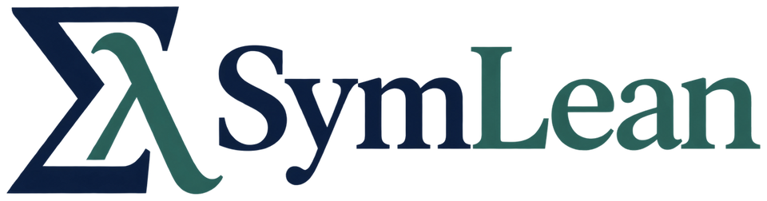

<h1 align="center">
  <picture>
    <source media="(prefers-color-scheme: dark)" srcset="Site/Static/brand/symlean-logo-dark.png">
    
  </picture>
  A Verified Computer Algebra System
</h1>

I wanted to do the calculations in my proofs the way I do them in Mathematica, and keep a proof at the
end. So we built SymLean. Ask for a derivative, an integral, the roots of a polynomial, or a bound on a
box. You get the answer and a theorem about Mathlib's functions, including the hypotheses it needs,
such as a nonzero denominator. Lean's kernel checks the proof, and if SymLean can't prove an answer, it
refuses and tells you what was missing.

You never have to trust SymLean's code. The search only proposes an answer, and what you get back is a
theorem the kernel accepted. To trust an answer, you read the statement it proves and run the checks
[below](#building-and-checking).

The same calculations work inside a proof: `cas` handles identities, derivatives, integrals and limits,
and `cega` handles numerical bounds.

## Example

```lean4
import CAS

#cas [integrate x] (atan x)                    -- x*atan(x) - 1/2*log(1 + x^2)

theorem integral_x_exp : ∫ x in (0 : ℝ)..1, x * Real.exp x = 1 := by
  cas
```

For the antiderivative of arctan x, the search proposes F(x) = x arctan x − log(1 + x²)/2. SymLean
computes F′ with a verified differentiator, shows that F′(x) − arctan x is 0 with a verified
normalizer, and Mathlib's fundamental theorem of calculus turns that into the theorem that ∫ₐᵇ arctan x dx
is F(b) − F(a) for all real a and b. A wrong proposal would fail the check of F′.

The conditions matter because Lean's functions are total. In Lean 1/0 = 0 and log 0 = 0, so an identity
printed without its conditions can be false. `#cas [simplify] ((x ^ 4 - 1) / (x ^ 2 - 1))` answers
x² + 1 under the condition x² − 1 ≠ 0, and the theorem behind it assumes `x * x - 1 ≠ 0`.

`#cas [roots x] (x ^ 5 - x - 1 = 0)` prints the one real root, 1.16730397826141868425, and the
proposition the kernel checked: an open interval of width 10⁻²⁰ around it contains exactly one root, and
every real root lies in it. The report also says how the root was isolated, which is explanation and
proves nothing.

## Why

Computer algebra systems sometimes give wrong answers, usually because an answer only holds under a
condition they don't print. Here are three:

- Richard Fateman's review of Mathematica ([J. Symbolic Computation 13(5),
  1992](https://doi.org/10.1016/S0747-7171%2810%2980011-2)) reports that
  `Integrate[1/x^2, {x, -1, 1}]` gave −2, which is what −1/x gives at the endpoints, across the pole at
  0. The integral diverges.
- SymPy 1.14.0 gives −1 for `integrate(sqrt(2 - x)*sqrt(1/(2 - x)), (x, 0, 1))`, although the integrand
  is 1 on [0, 1] ([sympy#29792](https://github.com/sympy/sympy/issues/29792), open on 2026-11-08).
- In Sage 10.2 to 10.9 the reduced echelon form of some sparse rational matrices was wrong, a 2 × 3
  matrix among them ([sagemath/sage#42411](https://github.com/sagemath/sage/issues/42411), fixed in
  Sage 10.10).

SymLean gives none of these wrong answers. On Fateman's integral our own search proposes −2 as well,
but the proof then needs x ≠ 0 on all of [−1, 1], so `#cas [integrate x in [-1, 1]] (1 / x ^ 2)`
refuses:

```text
error: `cas` did not prove the value -2 of the integral: it could not prove that the conditions of the primitive -(1/x) hold on the interval (x ≠ 0). Where they fail, the difference of the primitive's values at the endpoints need not be the integral. For a numerical value use `#cas [nintegrate x in [-1, 1]] (1 / x ^ 2)`.
```

On SymPy's integrand our search finds no antiderivative and says so. For the matrix from Sage's report,
SymLean returns row operations E with a theorem that E A = R, with E invertible and R in reduced echelon
form, which determines R. The site page "Why SymLean" (`Site/Pages/guide/why.md`) has more cases.

## What you need to trust

- the statement of the answer: the one you wrote, or the one the `#cas` report prints;
- the Mathlib definitions it mentions, such as `Real.arctan` or the interval integral;
- Lean's kernel, with the three standard axioms `propext`, `Classical.choice` and `Quot.sound`.

You never trust a search: not ours, not Hex's in the optional `CASHex`, and not SymPy, SageMath, FLINT,
Maxima, PARI/GP or Gappa, which the optional `CASOracle` calls through DSLean. Any of them can be wrong,
and what they return becomes an answer only through a proof the kernel accepts.

A few answers mention SymLean's own definitions, and then you read those too. They are short:

- Special functions and algebraic numbers: `CAS.erf`, `CAS.Analysis.SpecialFunctions.legendre`,
  `CAS.AlgRoot.real` and `CAS.AlgRoot.complex`, two lines each, with the coefficient readers
  `coeffEval` and `polyC` (Mathlib's `Polynomial.ofCoeffList` mapped to `ℂ`). Mathlib v4.35.0 has no
  error function, so `CAS.erf` takes the definition of Mathlib pull request
  [#34053](https://github.com/leanprover-community/mathlib4/pull/34053).
- Numerical bounds: the four certificate relations of `CAS/Certificate/Relations.lean` (`EnclosedOn`,
  `BoundOn`, `ApproxOn` and `ResidualBound`, two or three lines each), the expression evaluator
  `CAS.Exact.exprFn` with the expression type `CAS.Verified.Expr` and its evaluation (about 50 lines in
  all), and the rational boxes they range over (about ten lines).

A report prints its statement through Lean's pretty printer, which hides coercions. When that matters,
put the statement in your own file and prove it there. For `simplify`, `derive` and antiderivatives,
`set_option cas.suggest true` writes that `example` for you.

## What it covers

- algebra and simplification, polynomials and rational functions: partial fractions, gcds, Gröbner
  bases and ideal membership
- calculus: derivatives and regularity, exact and improper integrals, limits, Taylor and Laurent series
- sums and linear recurrences
- polynomial equations and inequalities, and complete lists of the real and complex roots of a polynomial
- linear algebra over the rationals, up to eigenvalues and eigenvectors
- linear ODEs, and certified enclosures of the solutions of scalar first-order polynomial ODEs
- Laplace transforms, Fourier transforms of Gaussians and Fourier coefficients
- number theory, and special functions such as Bernoulli numbers, zeta values, orthogonal polynomials,
  erf and Bessel functions
- certified numerics with [FloatLib](https://github.com/lean-dojo/FloatLib): decimal digits, bounds on
  rational boxes, and numerical integrals with a proved error

## Using it

SymLean builds with Lean `v4.35.0` and Mathlib `v4.35.0`. Add it to your `lakefile.lean`:

```lean4
require SymLean from git "https://github.com/Robertboy18/SymLean.git" @ "main"
```

then run `lake update SymLean` and `lake exe cache get`, and start a file with `import CAS`.
`#cas [mode] e` prints an answer with the theorem behind it, and variables need no declaration. The
tactic `cas` proves exact goals and `cega` numerical ones, and `cas?` and `cega?` suggest the explicit
proof to keep.

```lean4
import CAS

#cas [derive x] (x ^ 3)                        -- 3*x^2
#cas (gamma (5/2))                             -- 3√π/4

example (x : ℝ) (hx : x ≠ 0) : x / x = 1 := by
  cas

example (x : ℝ) (h0 : 0 ≤ x) (h1 : x ≤ 1) : x * (1 - x) ≤ 1 / 4 := by
  cega
```

Without `hx` the first example fails and names the missing hypothesis `x ≠ 0`.

If your library reads files into proofs with `include_str` or `json_data%`, Lake rebuilds a module when
its source changes but not when such a file does. Add SymLean's facet to the library's `needs` and Lake
tracks those files too, as the library guide (`Site/Pages/guide/library.md`) explains:

```lean4
lean_lib MyLib where
  needs := #[`@/MyLib:SymLean.embeddedInputs]
```

`lake -R -Khex=on build CASHex`, after the setup in `Site/Pages/guide/hex.md`, adds factorization,
irreducibility, Bareiss determinants and primality certificates from
[Hex](https://github.com/leanprover/hex), the Lean FRO's verified computer algebra. It is off by
default, and no module of `CAS` imports it.

## Using SymPy, SageMath and other systems

Some searches are better done by a mature computer algebra system, so I let one do them. With
`oracle := sympy`, SymLean asks SymPy for a proposal and then proves the statement in Lean, or
refuses:

```lean4
import CASOracle.Integrate

#cas [integrate x, oracle := sympy] (x ^ 2 * sin x)  -- -(x^2*cos(x)) + 2*x*sin(x) + 2*cos(x)
```

SymPy proposes the antiderivative, and SymLean checks it by differentiating, the same way it checks
its own proposals. Nothing an oracle says is trusted. A wrong answer, a missing program or a timeout
is a refusal with the reason, and what can't be checked, such as whether a factor is irreducible or
a list of solutions is complete, is printed as a hint and is not part of the theorem.

| Oracle | Program | What it proposes |
| --- | --- | --- |
| `sympy` | SymPy | integrals, factors, Gröbner bases, solutions, roots, numerical integrals, eigenvalues, ODE solutions, sums, sums of squares, and proofs for `cas` |
| `sage` | SageMath | integrals, factors, Gröbner bases, solutions, numerical integrals, eigenvalues, ODE solutions, sums |
| `maxima` | Maxima | integrals, factors |
| `pari` | PARI/GP | factors in one variable, roots of a polynomial, numerical integrals, eigenvalues |
| `flint` | FLINT | factors, roots of a polynomial, numerical integrals, eigenvalues |
| `gappa` | Gappa | enclosures |

The oracles live in the optional library `CASOracle`, which no module of `CAS` imports. Build it with
`lake -R -Koracle=on build CASOracle`, which also fetches our Lean 4.35 port of
[DSLean](https://github.com/taterowney/DSLean), the library that talks to the programs. SymPy, PARI
and FLINT run in the Python of `SYMLEAN_ORACLE_PYTHON` (or `python3`) with `sympy` (and `cvxpy` for
sums of squares), `cypari2` or `python-flint` installed, and SageMath, Maxima and Gappa are the
programs that `SYMLEAN_SAGE_PATH`, `SYMLEAN_MAXIMA_PATH` and `SYMLEAN_GAPPA_PATH` point to.
`bash tests/oracle/run.sh` runs the oracle tests with the real programs. On our machine the SymPy,
FLINT and PARI tests pass. We haven't run the SageMath, Maxima and Gappa ones there, since those
programs aren't installed on it. The site page `Site/Pages/ref/oracle.md` has every mode and option.

## Building and checking

Requires [elan](https://github.com/leanprover/elan), which installs the Lean version pinned in
[`lean-toolchain`](lean-toolchain). First download Mathlib's prebuilt files, then check all proofs:

```sh
lake exe cache get
lake build
```

This builds FloatLib and SymLean's 630 modules, the examples included, with warnings as errors, in
about ten minutes on 8 cores.

Inspect the axioms of a theorem proved by `cas`. They should be the three standard ones:

```sh
printf 'import CAS\ntheorem t : ∫ x in (0 : ℝ)..1, x * Real.exp x = 1 := by cas\n#print axioms t\n' | lake env lean --stdin
```

```text
't' depends on axioms: [propext, Classical.choice, Quot.sound]
```

You should also make sure that nothing in the library goes around the kernel: no extra axiom, and no compiled code
that replaces a definition. A plain grep doesn't work well here, because a tactic library talks about
`sorry` and axioms in its messages, so this script asks Lean instead, constant by constant (about four
minutes and 4.5 GB):

```sh
bash scripts/audit.sh
```

It finds no `extern`, no axiom of SymLean's own and no theorem that uses anything beyond the three
standard axioms. It lists 22 constants, and none of them can reach a theorem:

- 8 unsafe definitions and 8 `implemented_by` attributes evaluate a term while Lean elaborates, or keep
  very large number literals out of the C code that Lean generates. One of them,
  `CAS.Numerics.natCompactImpl`, shows `lcProof` because it calls Lean's own `unsafeBaseIO`.
- 6 `csimp` lemmas, one per constant, are proved equations that compiled code uses.

It also counts 158 opaque and 481 partial constants, which come from `partial def`s and their compiled
copies. The kernel rejects any theorem or safe definition that mentions an unsafe constant. A `partial
def` becomes a safe opaque constant, which definitions and theorems may mention (`CAS.Numerics.natOfLimbs`
calls the partial `natOfLimbsRange`), but the kernel never unfolds it, so no proof can use its code.
`TRUST.md` lists everything a proof trusts, with the reason for each item, and `BUGS.md` every known
bug and review finding with its status.

## Fast certificates

By default the kernel checks every proof, numerical certificates included. Large finite certificates,
such as a long table of inequalities, are slow in the kernel, so `cega [fast]` can evaluate them with
compiled code instead:

```lean4
set_option cega.nativeCertificates true in
theorem fast_rows : ∀ i : Fin 64, (i.val : ℤ) ^ 2 < 4096 := by
  cega [fast]

#print axioms fast_rows
-- 'fast_rows' depends on axioms: [propext, fast_rows._native.cegaFast.ax_1_1]
```

That also trusts Lean's compiler, and the theorem says so in its axioms (the suffix of the native
axiom's name depends on the elaboration mode: `ax_1` with `Elab.async` off). Without the option,
`cega [fast]` is plain `cega`. The option can also be set for a whole build with
`lake build -R -Kcertificates=fast`, which builds into `.lake/build-fast`. Exponentials, logarithms and
the other analytic routes are checked in the kernel in every profile.

## Performance

SymLean is slower than Mathematica or SymPy, because every answer pays for a proof. I care about every
answer being a theorem first and about speed second. Here is what the examples above cost, measured with
Lean v4.35.0 on 8 cores of a shared 96-core machine, one `lake env lean` run per line. The first line is
`import CAS` itself; each other line is what that example adds to it, the mean of two runs.

| What | Time |
| --- | ---: |
| `import CAS` | 4.5 s, and 4 GB of memory (17 s the first time, while the files come from disk) |
| `#cas [roots x] (x ^ 5 - x - 1 = 0)` | 0.3 s |
| `∫ x in (0 : ℝ)..1, x * Real.exp x = 1 := by cas` | 0.4 s |
| refusing Fateman's integral of `1 / x ^ 2` on [-1, 1] | 1.0 s |
| `x * (1 - x) ≤ 1 / 4` on [0, 1] by `cega` | 0.3 s |
| 2,000 integer inequalities, checked in the kernel | 3.3 s |
| the same 2,000 with `cega [fast]` | under 0.1 s |
| 20,000 with `cega [fast]` | under 0.1 s |
| 20,000 in the kernel | stops at Lean's default recursion limit |

Finite tables are where the kernel is slow, which is what the fast profile is for.

## Limitations

- A refusal proves nothing. A search can miss an answer that exists, and SymLean doesn't compute
  everything Mathematica can.
- An answer is correct, but complete only when the theorem says so, as with `roots`. `findRoot` proves
  one root and its uniqueness near the printed value.
- A certified bound on a residual is not a bound on an error. It becomes one only through a stability
  theorem that your own proof supplies.

## Documentation and contributing

The documentation is the website in `Site/`: a page for every mode, function, tactic and option, guides
by area, and tutorials. `bash Site/Tools/build.sh` builds it into `_out/site` and compiles every example
on it, except the Hex and oracle examples, which it quotes from files that only their own builds compile.
To contribute, follow Mathlib's conventions, keep every proof complete, and check a change with
`lake build`, `bash tests/cega/run.sh`, `bash tests/docs/run.sh` and `bash tests/lake/run.sh`, and
`bash scripts/dups.sh`, which fails when the library gains duplicate definitions or theorems,
restatements of Mathlib, unused declarations or equivalence pairs (against `scripts/dups.baseline`).

## Related work

The idea of letting an untrusted search propose and the prover check is old, and SymLean builds on a
lot of earlier work.

- Harrison and Théry combined HOL with Maple this way, with Maple searching and HOL proving the result
  ("A Skeptic's Approach to Combining HOL and Maple",
  [J. Automated Reasoning 21, 1998](https://doi.org/10.1023/A:1006023127567)).
- Ballarin, Homann and Calmet connected Isabelle and Maple ("Theorems and Algorithms: An Interface
  between Isabelle and Maple", [ISSAC 1995](https://doi.org/10.1145/220346.220366)).
- Delahaye and Mayero simplified field expressions in Coq with Maple and checked the results in Coq
  ([J. Symbolic Computation 39, 2005](https://doi.org/10.1016/j.jsc.2004.12.004)).
- Harrison verified nonlinear real formulas in HOL Light with sums of squares found by a numerical
  solver ([TPHOLs 2007](https://doi.org/10.1007/978-3-540-74591-4_9)), and Rocq's `psatz` works the
  same way.
- Li, Passmore and Paulson decide univariate polynomial problems in Isabelle/HOL from certificates that
  Mathematica computes ([J. Automated Reasoning 62, 2019](https://doi.org/10.1007/s10817-017-9424-6)).
- Lewis connected Lean and Mathematica ([PxTP 2017](https://doi.org/10.4204/EPTCS.262.4)), and Lewis
  and Wu then used Mathematica as an untrusted oracle from Lean 3
  ([J. Automated Reasoning 66, 2022](https://doi.org/10.1007/s10817-021-09611-1)).
- In Mathlib, `linarith` checks the certificates of an untrusted search, and `polyrith` checked
  SageMath's until it was withdrawn in 2025
  ([mathlib4#29547](https://github.com/leanprover-community/mathlib4/pull/29547)).

Computer algebra inside a prover:

- Kaliszyk and Wiedijk built a computer algebra system on top of HOL Light ("Certified Computer
  Algebra on Top of an Interactive Theorem Prover",
  [Calculemus 2007](https://doi.org/10.1007/978-3-540-73086-6_8)).
- Grégoire and Mahboubi's `ring` in Coq normalizes by reflection
  ([TPHOLs 2005](https://doi.org/10.1007/11541868_7)), the approach behind SymLean's normalizer and
  Mathlib's `ring`.
- In Isabelle/HOL, Thiemann and Yamada formalized algebraic numbers
  ([ITP 2016](https://doi.org/10.1007/978-3-319-43144-4_24)), Divasón, Joosten, Thiemann and Yamada
  verified Berlekamp–Zassenhaus factorization
  ([J. Automated Reasoning 64, 2020](https://doi.org/10.1007/s10817-019-09526-y)), and Eberl verified
  real asymptotics and limits ([ISSAC 2019](https://doi.org/10.1145/3326229.3326240)).
- [Hex](https://github.com/leanprover/hex), the Lean FRO's verified computer algebra, proves
  factorization, determinants and primality in Lean; SymLean's optional `CASHex` uses it.
- [SciLean](https://github.com/lecopivo/SciLean) brings scientific computing to Lean 4, with symbolic
  manipulation and automatic differentiation.

Certified numerics:

- Melquiond's interval methods in Coq prove bounds on real functions
  ([IJCAR 2008](https://doi.org/10.1007/978-3-540-71070-7_2)), and Mahboubi, Melquiond and
  Sibut-Pinote extended them to definite integrals
  ([J. Automated Reasoning 62, 2019](https://doi.org/10.1007/s10817-018-9463-7)).
- MetiTarski proves inequalities between real special functions automatically
  ([J. Automated Reasoning 44, 2010](https://doi.org/10.1007/s10817-009-9149-2)).
- In Lean, Irving and coauthors built conservative interval arithmetic
  ([girving/interval](https://github.com/girving/interval)), and
  [LeanCert](https://github.com/alerad/leancert) proves bounds and roots by verified interval
  arithmetic.

SymLean follows the same idea. What's new, I think, is how much of a computer algebra system you can
reach this way from one Lean front end, with everything checked in the kernel by default.

## Credits

SymLean is built by a team at Caltech: Robert Joseph George and Anima Anandkumar, in collaboration with
Thomas Y. Hou, Changhe Yang and Peicong Song. It is built on Mathlib (The mathlib Community, "The Lean
Mathematical Library", CPP 2020, <https://doi.org/10.1145/3372885.3373824>). The certified numerics use
[FloatLib](https://github.com/lean-dojo/FloatLib) by Robert Joseph George, Will Adkisson and Anima
Anandkumar, and the Hex routes use [Hex](https://github.com/leanprover/hex) by the Lean FRO and the Hex
contributors. We're in touch with the Hex team about how the two projects fit together. DSLean is by
taterowney and the DSLean contributors (CC BY 4.0, see [NOTICE](NOTICE)).

## License

SymLean is released under the Apache License 2.0; see [LICENSE](LICENSE) and [NOTICE](NOTICE).
